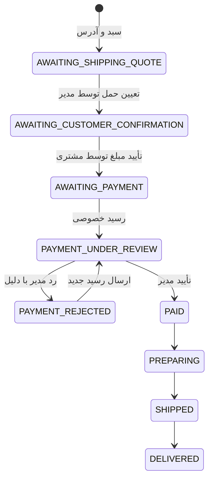

# تصمیم‌های معماری و مسیر توسعه

## مرز فاز اول

فاز اول شامل اسکلت اجرایی، طراحی فارسی، کاتالوگ fixture، فرم اعتبارسنجی نمونه، پنل خواندنی و طرح داده است. سبد localStorage فقط ابزار بررسی رابط است و برای قیمت یا موجودی قابل اعتماد نیست. در این فاز API تغییردهنده، ثبت‌نام، نشست، فایل رسید، پیامک و پرداخت وجود ندارد.

برای جلوگیری از اشتباه با فروشگاه واقعی، صفحات و پنل برچسب نمونه دارند؛ robots نیز index و follow را غیرفعال می‌کند. این تنظیم جایگزین مجوزهای سرور نیست.

## تصمیم‌های داده

- Product از ProductVariant جداست؛ قطر و ضخامت متعلق به مدل و قیمت و موجودی مستقل‌اند.
- مقادیر فنی Decimal، تعداد صحیح و مبالغ BigInt بر حسب تومان هستند.
- Inventory دو مقدار onHand و reserved دارد؛ موجودی قابل فروش تفاوت این دو است.
- InventoryReservation به سفارش و مدل متصل است و مهلت و وضعیت دارد.
- OrderItem قیمت و مشخصات زمان خرید را به صورت snapshot نگه می‌دارد.
- Order آدرس را snapshot می‌کند تا ویرایش دفترچه آدرس سفارش قدیمی را تغییر ندهد.
- shippingToman و totalToman پیش از اعلام هزینه حمل null هستند؛ صفر به معنی «نامعلوم» نیست.
- Payment برای هر تلاش پرداخت رکورد مستقل دارد و کلید ذخیره‌سازی خصوصی را نگه می‌دارد؛ URL عمومی رسید نگهداری نمی‌شود.
- روابط سفارش، پرداخت و سوابق با Restrict محافظت می‌شوند تا حذف محصول یا مشتری، تاریخچه مالی را نابود نکند.
- فقط یک ADMIN و فقط یک آدرس پیش‌فرض برای هر کاربر با index جزئی مجاز است.
- Review دارای وضعیت تأیید و امتیاز ۱ تا ۵ است. DiscountCampaign درصد و بازه معتبر دارد.
- AuditLog به مدیر انجام‌دهنده، نوع عملیات و موجودیت متصل است؛ دادهٔ حساس نباید در metadata ثبت شود.

این ساختار نقطه شروع است. قواعد بین چند جدول، مانند حداقل تعداد بر اساس نوع محصول، در سرویس تراکنشی سمت سرور اجرا خواهند شد و صرف وجود schema آن‌ها را پیاده‌سازی نمی‌کند.

## چرخه سفارش پیشنهادی

لغو با فرمان مدیر و ثبت دلیل در وضعیت‌های مجاز انجام می‌شود. انقضای خودکار وضعیت مستقل EXPIRED دارد و لغو توسط مشتری نیست. تغییر وضعیت‌ها به یک state machine در سرویس سفارش محدود خواهد شد؛ کلاینت نباید مستقیماً status را ارسال و ذخیره کند.

### جلوگیری از فروش بیش از موجودی در فاز دوم

۱. شناسه مدل و تعداد از کلاینت دریافت شود؛ قیمت، نوع، فعال بودن محصول و موجودی فقط از دیتابیس خوانده شوند.

۲. در تراکنش، مدل‌ها با ترتیب ثابت قفل شوند یا به‌روزرسانی شرطی اتمیک با `onHand - reserved >= quantity` انجام شود. سپس reserved و InventoryReservation و سفارش هم‌زمان ثبت شوند. در تعارض تراکنشی، retry محدود لازم است.

۳. quote و قیمت snapshot، دارای مهلت مشخص باشند. تأیید مشتری فقط با quote معتبر و رزرو فعال انجام شود. سیاست تغییر قیمت میان quote و تأیید باید پیش از پیاده‌سازی نهایی مشخص شود.

۴. worker زمان‌بندی‌شده با قفل و عملیات idempotent، رزروهای فعالِ منقضی را آزاد و سفارش را EXPIRED کند. تأیید، لغو و انقضا باید بر سر همان قفل/وضعیت رقابت کنند.

۵. پس از تأیید پرداخت، reserved و onHand هم‌زمان کم و رزرو CONSUMED شود. آزادسازی فقط از ACTIVE مجاز باشد؛ اجرای دوبارهٔ worker یا webhook نباید موجودی را دوباره تغییر دهد.

۶. هنگام بررسی رسید، سیاست انقضا باید از پذیرش پرداخت پس از آزادشدن رزرو جلوگیری کند. مهلت بررسی و رفتار رسید دیرهنگام تصمیم کسب‌وکار است و در فاز اول فرض نشده است.

آزمون‌های integration باید چند خرید هم‌زمان برای آخرین موجودی، تأیید هم‌زمان با انقضا، تکرار تأیید پرداخت و آزادسازی دوباره را پوشش دهند.

## احراز هویت، پیامک و مجوزها در فاز دوم

- گذرواژه با الگوریتم مناسب مثل Argon2id هش شود؛ plaintext در دیتابیس، لاگ یا fixture قرار نگیرد.
- نشست opaque با توکن تصادفی، ذخیرهٔ هش، کوکی HttpOnly/Secure/SameSite و انقضا پیاده‌سازی شود. SESSION_SECRET صرفاً جای رزروشده در env است و اکنون مصرف نمی‌شود.
- تمام Server Actionها، Route Handlerها و سرویس‌های مدیریت، requireAdmin سمت سرور داشته باشند. مخفی کردن دکمه یا کنترل middleware به تنهایی کافی نیست.
- کاربران فقط به آدرس، سفارش، رسید و تیکت خود دسترسی داشته باشند؛ کنترل مالکیت در هر خواندن و نوشتن اعمال شود.
- Zod در مرز سرور اعتبارسنجی کند؛ اعتبارسنجی فعلی فرم فقط برای تجربه کاربری است.
- تلاش ورود، OTP، بازیابی و ثبت‌نام با محدودیت مشترک قابل اتکا کنترل شوند. codeHash، زمان انقضا، شمار تلاش و مصرف یک‌بار OTP در مدل پیش‌بینی شده‌اند.
- قرارداد SmsProvider با عملیات ارسال OTP، از سرویس‌دهنده ایرانی جدا شود. adapter توسعه فقط با opt-in و فقط در NODE_ENV=development فعال شود؛ production بدون تنظیم سرویس واقعی fail-closed باشد. SMS_PROVIDER فعلی disabled است و هیچ پیامکی ارسال نمی‌شود.
- ایجاد مدیر اولیه با فرمان محدود و ورودی محیطی انجام شود؛ هیچ اعتبارنامه پیش‌فرضی وجود نداشته باشد.
- درخواست‌های تغییردهنده با بررسی origin و روش مناسب در برابر CSRF محافظت شوند. پاسخ و لاگ شامل رمز، OTP، token یا اطلاعات بانکی کامل نباشد.

## رسید پرداخت در فاز دوم

پیش‌فرض طراحی: فقط JPEG، PNG یا WebP تا ۵ MiB. این تصمیم در migration ثبت شده است و در صورت تغییر نیاز، migration جدید لازم دارد. نوع و محتوای واقعی فایل باید در سرور بررسی شود؛ Content-Type اعلام‌شده از مرورگر کافی نیست. نام تصادفی، ذخیرهٔ خصوصی خارج از public، بازرمزگذاری تصویر و دانلود با کنترل مالکیت/مجوز لازم‌اند. فایل HTML یا SVG پذیرفته نشود. در فاز اول endpoint یا فضای آپلود ایجاد نشده است.

## فرضیات ثبت‌شده

- محیط توسعهٔ فعلی Windows است؛ رابط بدون PostgreSQL هم اجرا می‌شود.
- حداقل ۱۰ شاخه به هر مدل لوله اعمال شده و اتصال و لوازم جانبی حداقل یک عدد دارند.
- انتخاب واحد فروش لوازم جانبی به صورت «عدد» در کاتالوگ نمونه است؛ بسته‌بندی واقعی باید تعیین شود.
- قیمت مشتری عادی و پیمانکار یکسان است؛ هیچ سطح قیمت اختصاصی در مدل نیست.
- دادهٔ واقعی، شماره تماس، آدرس، اطلاعات کارت و نشان اعتماد جعل نشده است.
- مدت رزرو، مهلت quote، سیاست تغییر قیمت، مهلت بررسی رسید و مقررات مرجوعی هنوز مشخص نیستند.

## مراحل فاز دوم

۱. PostgreSQL را آماده و migrationها را روی دیتابیس خالی اجرا کنید؛ constraint و indexها را با تست integration بررسی کنید.

۲. احراز هویت، ثبت‌نام، OTP، نشست، محدودسازی درخواست و مجوز مدیر/مشتری را پیاده‌سازی کنید.

۳. repository واقعی کاتالوگ، مدیریت دسته و محصول، فعال‌سازی مدل و مدیریت قیمت/موجودی با AuditLog را بسازید.

۴. سبد سمت سرور، آدرس‌ها، سفارش با تراکنش رزرو، محاسبه حمل، تأیید مشتری و worker انقضا را تکمیل کنید.

۵. پیکربندی بانکی با ورودی مالک، رسید خصوصی و تأیید/رد پرداخت را پیاده‌سازی کنید.

۶. پروفایل، تاریخچه و پیگیری سفارش، سفارش مجدد، فاکتور PDF فارسی، مقایسه، Excel import با پیش‌نمایش و اعتبارسنجی، جشنواره، بنر، نظر و تیکت را اضافه کنید.

۷. تست امنیت، دسترس‌پذیری، تراکنش هم‌زمان، پشتیبان‌گیری و بازیابی را انجام دهید؛ سپس در یک مرحله جدا و با دامنه و سرویس‌های تأییدشده برای انتشار آماده شوید.
